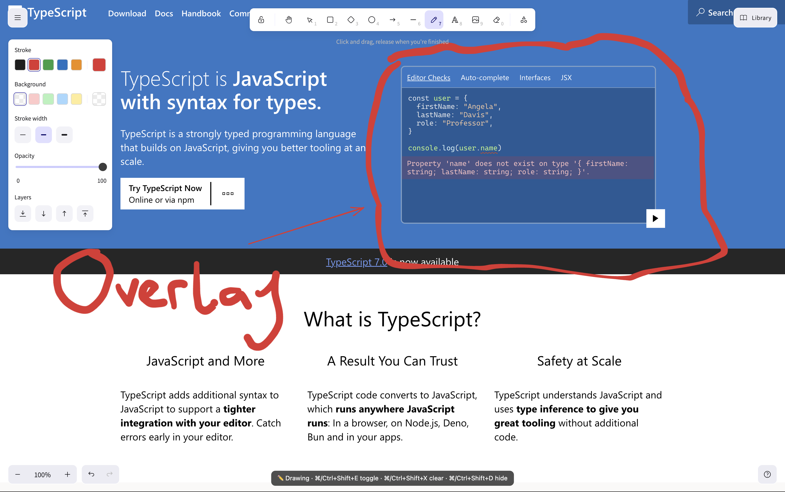

# Excalidraw Desktop

An unofficial desktop app for [Excalidraw](https://excalidraw.com), the open-source virtual whiteboard, with one extra trick: a transparent overlay that lets you draw directly on top of anything on your screen.

It's the same Excalidraw you know from [excalidraw.com](https://excalidraw.com), running in its own window, plus a draw-over-your-screen mode built for recording videos and live explanations.


## Features

- **Whiteboard window**: the full Excalidraw editor in a desktop window. Your board saves automatically between sessions.
- **Screen overlay**: a transparent, always-on-top drawing layer over your whole screen. Annotate code, websites or any app while you record.
- **Click-through mode**: keep your drawings on screen while clicks go to the apps underneath.
- **Global shortcuts** that work from any app.

## Shortcuts

| Shortcut | What it does |
| --- | --- |
| Cmd/Ctrl + Shift + D | Show / hide the overlay |
| Cmd/Ctrl + Shift + E | Switch the overlay between drawing and click-through |
| Cmd/Ctrl + Shift + X | Clear the overlay |

## Install the app

Requires [Node.js](https://nodejs.org) (LTS).

```bash
npm install
npm run dist
```

The built app goes in the `release` folder (`release/mac-arm64` on Apple Silicon, `release/mac` on Intel Macs). Drag **Excalidraw.app** into Applications. If macOS says it can't verify the app, right-click it and choose **Open** the first time.

## Development

```bash
npm install
npm run dev
```

Starts Vite and opens the app with hot reload for everything in `src/`. Changes to `electron/` need a restart.

### How it works

- `electron/main.cjs` creates two windows: the whiteboard and the overlay. The overlay is transparent, frameless and always on top, and `setIgnoreMouseEvents()` makes clicks pass through in click-through mode.
- `src/Overlay.jsx` renders Excalidraw with a transparent background and the pen tool selected.
- The overlay uses Excalidraw's light theme on purpose: dark theme inverts the canvas, which would shift your stroke colors.
- On macOS the overlay starts just below the menu bar, which always draws on top of other windows.

## Credits and license

This project is not affiliated with or endorsed by the Excalidraw team. All the whiteboard functionality comes from [Excalidraw](https://github.com/excalidraw/excalidraw), which is open source under the MIT license. This app wraps the [`@excalidraw/excalidraw`](https://www.npmjs.com/package/@excalidraw/excalidraw) package in Electron and adds the screen overlay.
